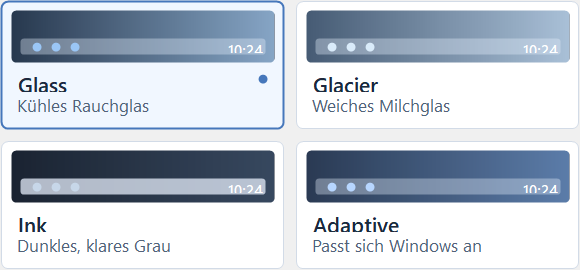
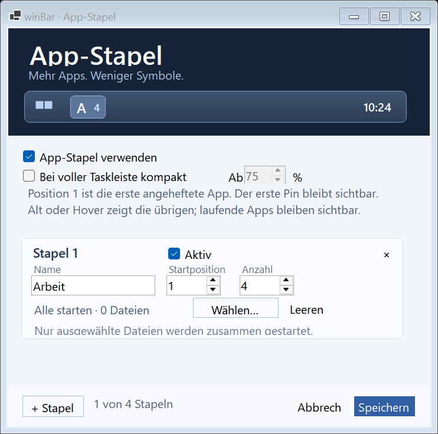

# winBar — a lightweight Windows 11 taskbar customizer

[](https://github.com/diffsource/winBar/actions/workflows/build.yml) [](https://github.com/diffsource/winBar/releases/latest)

**Make the Windows 11 taskbar feel quieter.** winBar is a lightweight taskbar customizer with glass themes, compact app stacks, a focus lens, an on-demand system tray, and a styled clock. Keep the Windows taskbar familiar while making room for the things you actually use. It runs locally, with no account or telemetry.

[Download the latest release](https://github.com/diffsource/winBar/releases/latest/download/TaskbarTweaker.zip) · [See all releases](https://github.com/diffsource/winBar/releases) · [Report an issue](https://github.com/diffsource/winBar/issues)



## Get started

1. Install the [.NET 10 Desktop Runtime for Windows x64](https://dotnet.microsoft.com/download/dotnet/10.0) if you do not already have it.
2. Download [TaskbarTweaker.zip](https://github.com/diffsource/winBar/releases/latest/download/TaskbarTweaker.zip) and extract it completely.
3. Run `TaskbarTweaker.exe`. Keep `TaskbarTap.dll` next to it.

A short welcome tour appears on first use. To reopen settings later, **hold Alt and move your pointer onto the taskbar**, press **Ctrl + Alt + S**, or use the **winBar tray icon**. Closing Settings leaves winBar running. Choose **Beenden (Exit)** from the tray icon menu to stop it and restore the taskbar.

## What you can customize

| Feature | What it does |
| --- | --- |
| **Glass themes** | Choose Glass, Glacier, Ink, or Adaptive. Fine-tune color and opacity, sample a subtle tint from the active app icon, or share a visual-only theme as JSON. |
| **App stacks** | Collapse up to four groups of adjacent pinned apps into their first icon. Hover or hold Alt to expand; running apps stay visible. Optionally compact only when space is tight, and launch a selected set together from the tray menu. |
| **Focus lens** | Keep the active app prominent and reveal other running app buttons with Alt. Pinned favorites remain within reach. |
| **Right side on demand** | Set clock, Quick Settings, tray icons, and language indicator independently to **Always**, **On demand**, or **Off**. On-demand items appear with Alt or when you approach the right edge. |
| **Clean preset** | Hide Search, Widgets, Task View, badges, and tray clutter together. Click again to restore the previous values. |
| **Clock and media** | Show a styled time display, reveal a second time zone on hover, and optionally show a slim media progress line with controls on hover. |
| **Folder shelf** | Open up to 20 selected folders from a compact popup with **Ctrl + Alt + O** or the tray menu. |
| **Scenes** | Save complete taskbar arrangements and switch manually or by monitor count and local time window. Existing Work/Personal profiles and **Ctrl + Alt + 1/2** still work. |
| **Presentation mode** | Hide the right side and selected private app buttons with **Ctrl + Alt + P** while sharing your screen. |
| **Hide app buttons** | Choose running programs or EXE files whose taskbar buttons should be hidden. Their windows remain open and accessible with Alt + Tab. |
| **Automatic updates** | Check stable GitHub releases in the background, verify the download, and use the new version on the next normal launch. No forced restart. |

You can also set taskbar alignment, grouping, auto-hide, Search, Widgets, Copilot, Chat/Teams, the desktop corner, and other Windows taskbar options. Some Windows settings need an Explorer restart before they appear.

### App stacks in action

Choose a contiguous range of Windows pins. The first pin stays as a small anchor; hovering it reveals the group. The editor previews the result before you apply it.



### Useful shortcuts

| Keys | Action |
| --- | --- |
| **Alt** while moving onto the taskbar | Reveal the settings button and on-demand elements |
| **Ctrl + Alt + S** | Open winBar Settings, even if the taskbar is hidden |
| **Ctrl + Alt + 1 / 2** | Apply the saved Work / Personal profile |
| **Ctrl + Alt + O** | Open the folder shelf |
| **Ctrl + Alt + P** | Toggle presentation mode |
| **Win + A / Win + N** | Open Windows Quick Settings / notifications directly |

## A few practical details

- **Windows 11 x64** is the target. The Explorer helper uses Windows 11 XAML internals, so a Windows update may temporarily break some effects. If a new version changes the helper, restart Explorer when convenient to load the new DLL.
- The app's current interface and first-use tour are in German; this README is in English for the wider Windows community.
- **App stacks and on-demand pinned apps** use Windows 11 XAML internals and are experimental. A stack covers adjacent pin positions in the current Windows order; it does not freely regroup arbitrary pins. The first pin is its anchor. Stack groups take precedence over the older pinned-app reveal option.
- **Auto compact** estimates crowding from taskbar width, configured pins, and running windows. It does not rearrange your Windows pins.
- **Hiding an app** affects its running taskbar buttons by full EXE path. It does not unpin the app, and some programs manage their own buttons.
- **The clock** sits over the Windows clock and lets clicks reach Windows. It hides during full-screen use. The second time zone appears only on hover.
- **Presentation mode** changes taskbar visibility only. It does not hide open windows or replace your screen-sharing app's privacy controls.
- **Scenes** can react to the number of connected monitors; they apply one taskbar arrangement at a time. The music line and folder shelf are optional and do no media or folder work while disabled.
- **Automatic updates** download from this repository's stable GitHub Releases. They are enabled by default and can be switched off in Settings. The first release with this feature is v1.0.2; earlier versions need one manual update. A staged update starts next time you launch winBar, so the current session is uninterrupted.
- Settings are stored in `%AppData%\TaskbarTweaker\settings.json`. Exported profiles and scenes can include full EXE paths; review them before sharing. Exported **themes** contain appearance values only.

## Build from source

You need the [.NET 10 SDK](https://dotnet.microsoft.com/download/dotnet/10.0) and Visual Studio with **Desktop development with C++** (MSVC x64). From the repository root:

```powershell
dotnet publish -c Release -o publish -p:PublishSingleFile=true --self-contained false
```

This builds `TaskbarTap.dll` from `tap/TaskbarTap.cpp`. Distribute `publish/TaskbarTweaker.exe` together with `publish/TaskbarTap.dll`. The [Windows build workflow](https://github.com/diffsource/winBar/actions/workflows/build.yml) also produces both files as an artifact.

## How it works

winBar uses Windows taskbar settings and `SetWindowCompositionAttribute` for appearance. A small native DLL runs inside Explorer to adjust the Windows 11 taskbar's XAML layer. Selected running app buttons use `ITaskbarList`. The Alt interaction is checked every 100 ms; heavier window checks run less often. Media uses Windows playback events, scene rules are evaluated at time or display changes, and the folder shelf scans nothing in the background. Updates are checked every 12 hours. There is no background service or installer. The Explorer integration uses undocumented Windows interfaces and may be flagged by security software.

## Help shape winBar

Have a bug report or a focused idea for a cleaner taskbar? [Open an issue](https://github.com/diffsource/winBar/issues). If winBar is useful to you, starring the repository helps other Windows users find it.

Built by [diffsource](https://github.com/diffsource).
